# QUIZIFY — Aplikasi Kuis Interaktif

**QUIZIFY** adalah proyek aplikasi kuis edukatif berbasis **Flutter** dengan backend **Laravel REST API**. Pengguna dapat menjelajahi kategori, mengerjakan kuis, melihat hasil, dan mengakses papan peringkat. Sistem ini juga menyediakan antarmuka pengelolaan template kuis dan pertanyaan untuk administrator.

> **Status:** proyek portofolio/pembelajaran. Screenshot berasal dari dokumentasi pengembangan aplikasi. Ketersediaan kode, rute, dan tampilan tidak dengan sendirinya menjamin seluruh fitur dapat berjalan tanpa konfigurasi lokal.

## Tampilan Aplikasi

### Pengguna — mulai belajar hingga melihat hasil

| Login | Registrasi | Beranda pengguna |
|:---:|:---:|:---:|
| 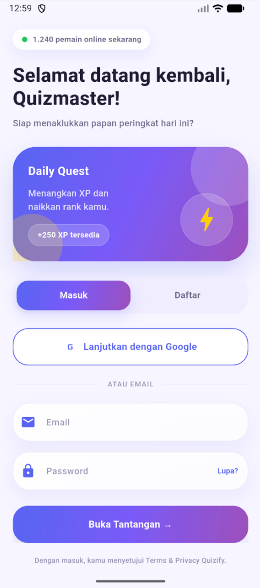 | 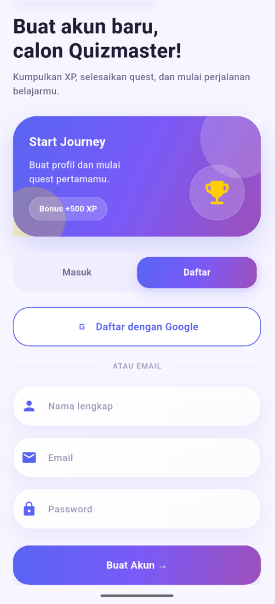 | 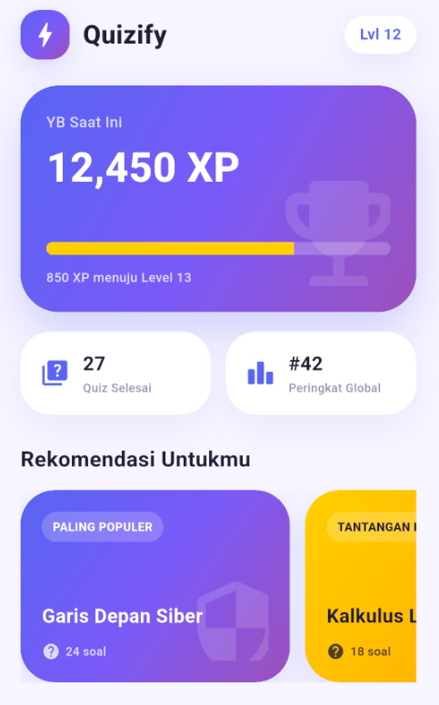 |

| Pilih kuis | Kerjakan soal | Lihat hasil |
|:---:|:---:|:---:|
| 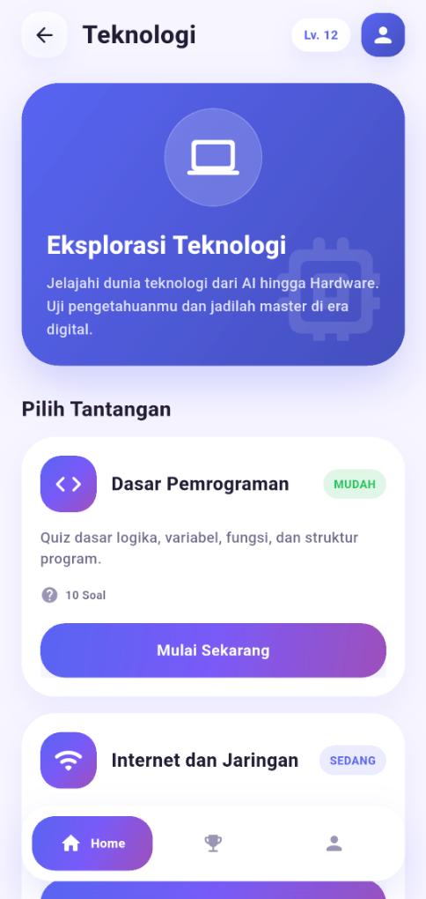 | 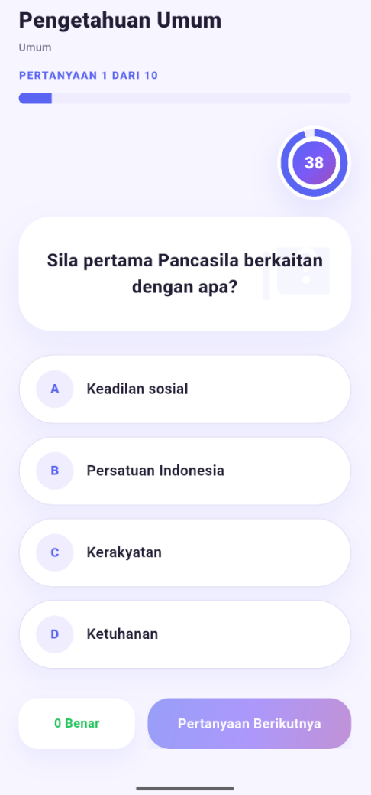 | 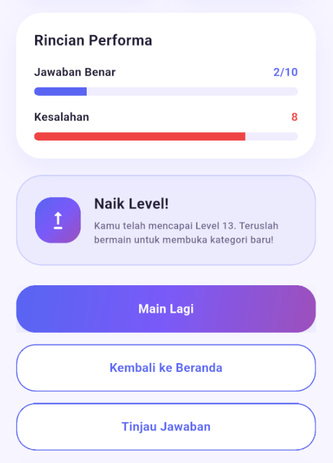 |

**Leaderboard:** menampilkan peringkat peserta, sesuai tampilan yang didokumentasikan.

<p align="center">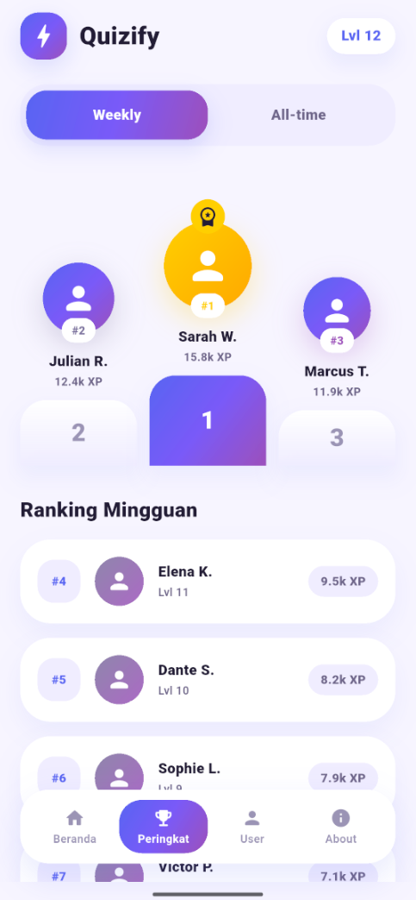</p>

### Administrator — pengelolaan konten kuis

| Dashboard admin | Kelola kuis | Kelola soal |
|:---:|:---:|:---:|
| 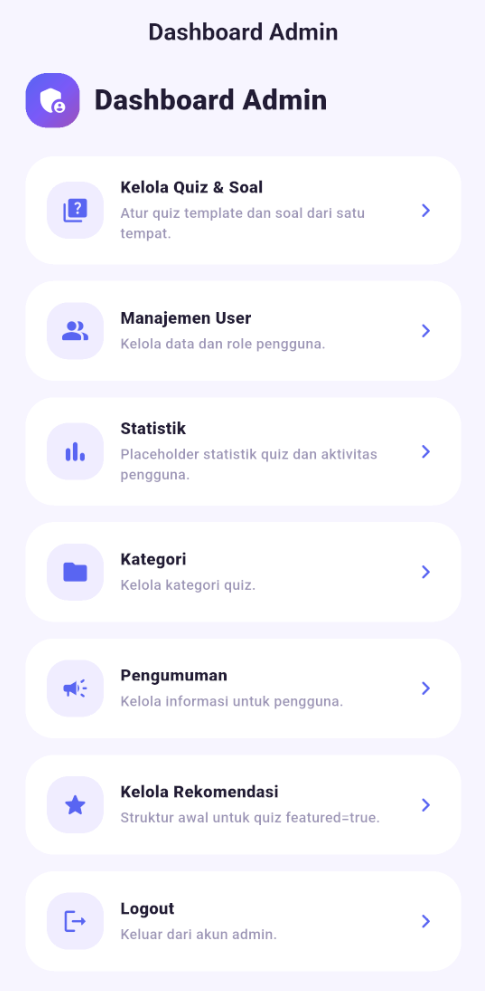 | 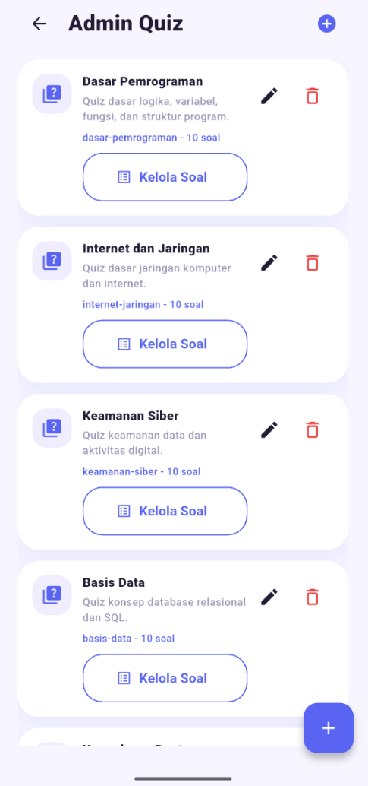 | 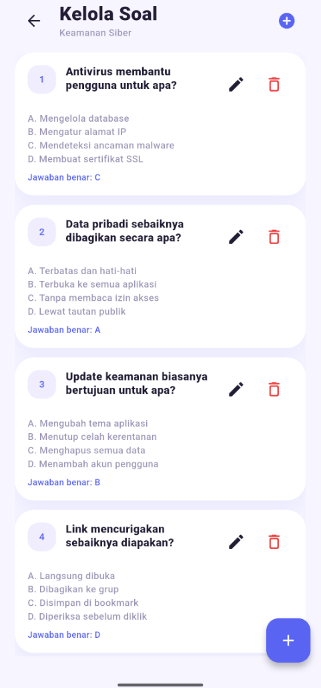 |

| Form tambah template | Form edit soal |
|:---:|:---:|
| 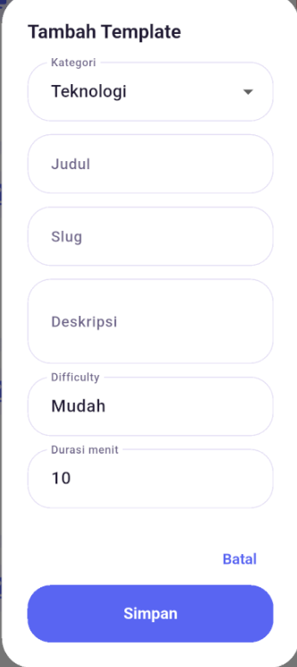 | 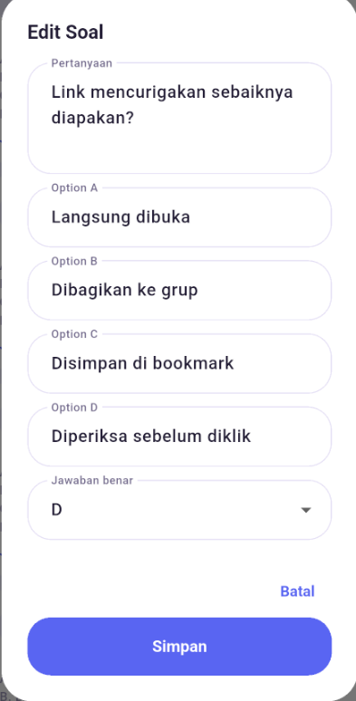 |

## Fitur yang Terdokumentasi

**Pengguna**
- Registrasi, login, dan logout melalui endpoint autentikasi.
- Melihat kategori, template, dan pertanyaan kuis.
- Mengirim hasil pengerjaan kuis melalui endpoint yang membutuhkan autentikasi.
- Mengakses dashboard pengguna dan leaderboard.

**Admin**
- Mengelola template kuis (menambah, mengubah, menghapus).
- Mengelola pertanyaan pada template kuis.
- Rute pengelolaan template dan pertanyaan menggunakan middleware `auth:sanctum` dan `admin`.

Fitur di atas dirangkum dari `routes/api.php`, implementasi klien Flutter, dan screenshot pengembangan; bukan klaim hasil pengujian end-to-end.

## Teknologi

| Bagian | Teknologi |
|---|---|
| Aplikasi mobile | Flutter, Dart |
| State management | Provider |
| Navigasi | GoRouter |
| HTTP client | `http` |
| Backend | PHP 8.2+, Laravel 12 |
| Autentikasi API | Laravel Sanctum 4 |
| Database | Mengikuti konfigurasi lokal Laravel; proyek dilaporkan menggunakan MySQL, tetapi pilihan database aktif tidak diverifikasi dari file konfigurasi yang diberikan |

## Struktur Repository

```text
QUIZIFY/
├── lib/                       # Source Flutter
│   └── services/api/          # Panggilan HTTP ke Laravel
├── assets/                    # Asset Flutter
├── android/                   # Konfigurasi Android
├── ios/                       # Konfigurasi iOS
├── quizify_backend/           # Source Laravel
│   ├── app/                   # Controller dan model
│   ├── database/              # Migration dan seeder
│   ├── routes/api.php         # REST API
│   └── composer.json
├── docs/screenshots/          # Screenshot proyek
├── pubspec.yaml
└── README.md
```

## Menjalankan Secara Lokal

### Prasyarat

- Flutter SDK dengan Dart SDK yang kompatibel dengan `sdk: ^3.11.0` pada `pubspec.yaml`.
- PHP 8.2 atau lebih tinggi dan Composer.
- Database lokal sesuai pengaturan `.env` Laravel (MySQL atau driver lain yang benar-benar dikonfigurasi).
- Android Emulator atau perangkat Android yang dapat mengakses server lokal.

### 1. Jalankan Laravel

Di root repository, buka terminal:

```powershell
cd quizify_backend
composer install
Copy-Item .env.example .env
php artisan key:generate
```

Atur variabel `DB_*` pada `.env` sesuai database milikmu. Buat databasenya terlebih dahulu jika diperlukan; **jangan gunakan `migrate:fresh` pada database berisi data penting**. Kemudian:

```powershell
php artisan migrate
php artisan serve --port=8000
```

Jika membutuhkan data contoh, tinjau seeder di `database/seeders/` sebelum memilih menjalankannya. Jaga terminal server tetap terbuka.

### 2. Jalankan Flutter

Buka terminal baru di root repository:

```powershell
flutter pub get
flutter run
```

Pada Android Emulator standar, backend yang berjalan di komputer host biasanya dapat diakses melalui `http://10.0.2.2:8000`.

Periksa alamat di `lib/services/api/quiz_api.dart`:

```dart
static const String baseUrl = 'http://10.0.2.2:8000/api';
```

Pada file yang ditinjau sebelumnya, ada **karakter backtick tambahan sebelum `/api`**. Pastikan karakter tersebut tidak ada di source yang dijalankan. Untuk Android fisik, gunakan alamat IP laptop yang dapat diakses dari jaringan perangkat, bukan `10.0.2.2`.

## Ringkasan REST API

Semua endpoint berikut diawali `/api`.

| Metode | Endpoint | Akses yang terlihat pada rute |
|---|---|---|
| POST | `/register`, `/login` | Publik |
| POST | `/logout` | Sanctum |
| GET | `/categories`, `/quiz-templates`, `/leaderboard` | Publik |
| GET | `/template-questions/{quizTemplateId}` | Publik |
| POST | `/quiz-results` | Sanctum |
| GET | `/user-dashboard` | Sanctum |
| POST, PUT, DELETE | `/quiz-templates`, `/quiz-templates/{id}` | Sanctum + admin |
| POST, PUT, DELETE | `/template-questions`, `/template-questions/{id}` | Sanctum + admin |
| GET, POST, PUT, DELETE | `/quizzes` dan `/quizzes/{id}` | Tidak terdapat middleware eksplisit pada file rute yang diperiksa |
| GET | `/quizzes/{id}/play` | Tidak terdapat middleware eksplisit pada file rute yang diperiksa |

> **Catatan keamanan:** rute mutasi `/quizzes` belum menampilkan middleware autentikasi pada `routes/api.php` yang ditinjau. Perlu memastikan kontrol otorisasi di controller atau lapisan lain sebelum backend dipublikasikan ke internet. Jangan mengunggah `.env`, credential, atau data pengguna nyata.

## Pengembang

**Arlen Prima Dinova**  
GitHub: [@arlendevID](https://github.com/arlendevID)  
Repository: [QUIZIFY](https://github.com/arlendevID/QUIZIFY)
